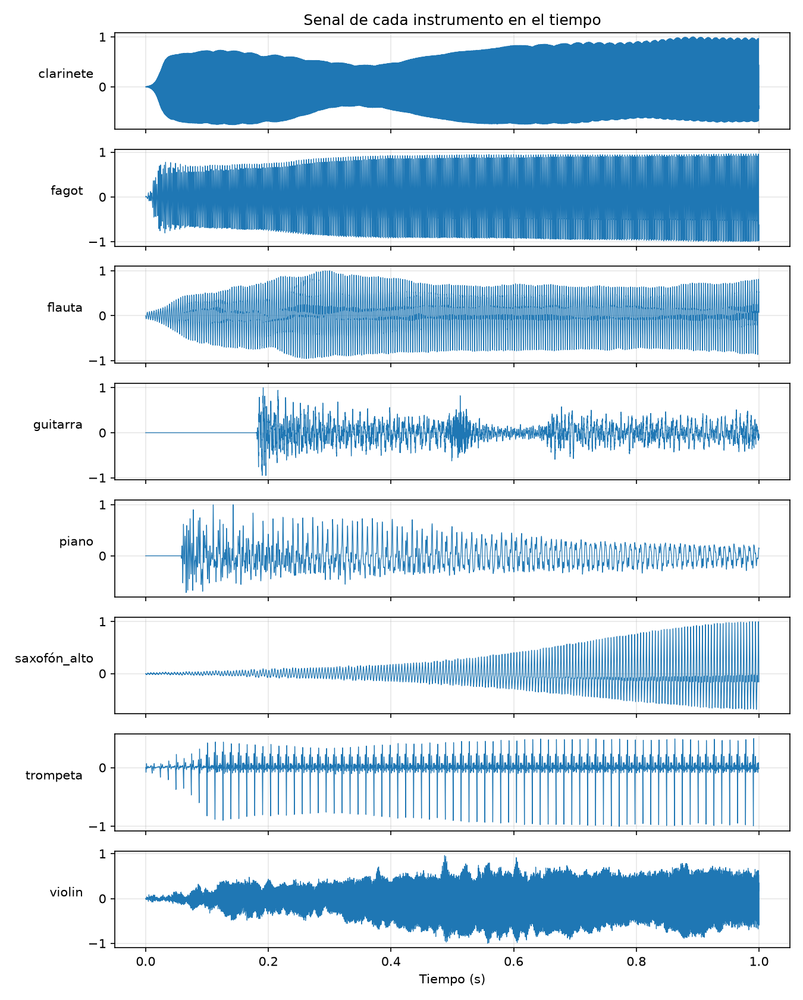
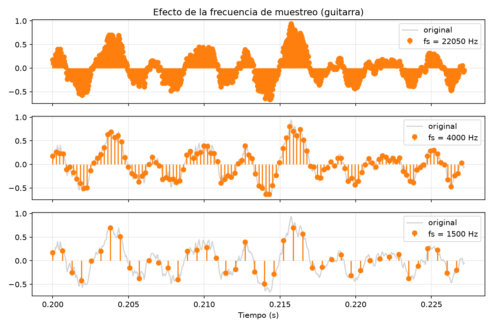
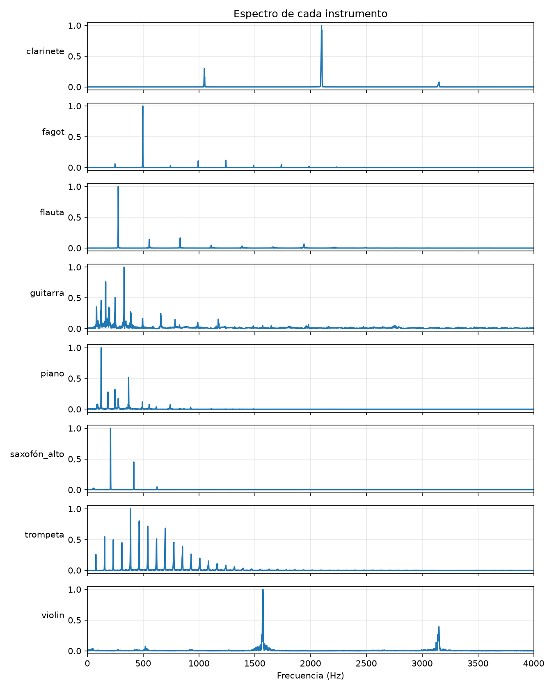
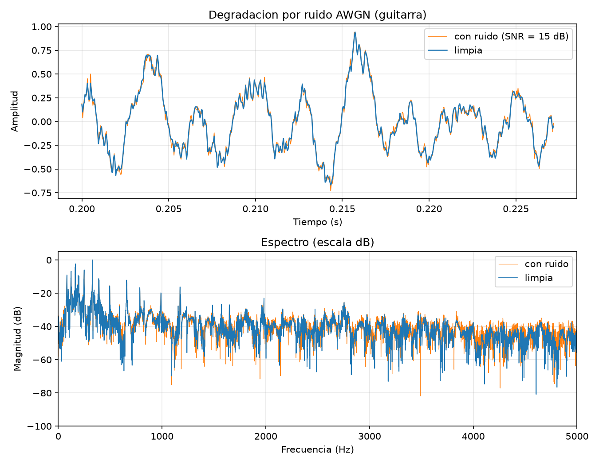

# reconocimiento de instrumentos musicales con analisis espectral

# tgs - segunda entrega

# Integrantes
- Carlos Manuel Muñoz Muñoz
- Jhon Eferson Hernández Montoya


## 2. Descripción breve

un sistema que pueda clasificar y reconocer instrumentos musicales a partir de señales de audio usando especialmente el timbre,
analisis temporal y la frecuencia

asi sea que dos instrumentos toquen la misma nota, el timbre es diferente, entonces la energia se reparte de forma distinta entre
los armonicos y el sonido ataca y se apaga de otra manera, con esa informacion nos permite diferenciarlos, en teoria se trabajaran con varios instrumentos.


## 3. Estado actual

**Implementado:**

- la carga de datos (archivos `.wav` en `data/`).
- la conversion a mono (promedio de canales).
- el re-muestreo a 22.050 Hz (`scipy.signal.resample_poly`, que incluye filtro antialiasing).
- el recorte al primer segundo de cada audio y normalizacion por el maximo en valor absoluto.
- la visualizacion en el tiempo.
- la demostracion del teorema de muestreo (efecto de reducir la frecuencia de muestreo).
- el analisis frecuencial con FFT (ventana hanning) y la estimacion del pico principal.
- el analisis de degradacion por ruido AWGN con SNR configurable.
- el guardado automatico de las graficas en `results/`.

**Pendiente para el Corte 3:**

- la extraccion formal de caracteristicas como el MFCC, centroide espectral y envolvente ADSR.
- integrar un modelo clasificador (machine learning).


## 4. Datos o recursos

los audios que se usaron estan en `data/`, un archivo `.wav` por cada instrumento, usamos el `.wav` porque no comprime y tambien
conserva la informacion de frecuencias, a diferencia del mp3, los archivos originales estan a 44.100 hz (algunos estan en estereo)
y el sistema los llevara a 22.050 hz mono.

las fuentes de los datos del proyecto son:

- **TinySOL (IRCAM):** subconjunto de las grabaciones *Studio On Line* de IRCAM (14 instrumentos, modo de ejecución ordinario), pensado para educación e investigación, por ejemplo reconocimiento de instrumentos. Información y documentación: [mirdata – TinySOL](https://mirdata.readthedocs.io/en/latest/_modules/mirdata/datasets/tinysol.html). Descarga: [búsqueda de TinySOL en Zenodo](https://zenodo.org/search?q=TinySOL).
- **Philharmonia Sound Samples:** biblioteca gratuita de muestras grabadas por músicos de la Philharmonia Orchestra. Sitio oficial: <https://philharmonia.co.uk/audio-sound-samples/>. Sus términos permiten usar las muestras en trabajos propios, pero no redistribuirlas tal cual.
- **Grabaciones propias:** audios grabados por el equipo.


## 5. Instrucciones de ejecución local

para ejecutarlo tiene que tener Python 3.9 o superior.

```bash
# 1. clonar el repositorio
git clone https://github.com/asist123/reconocimiento-instrumentos-teoria-senales.git
cd reconocimiento-instrumentos-teoria-senales

# 2. crear y activar el entorno virtual
python -m venv venv
#   windows (PowerShell):
venv\Scripts\Activate.ps1
#   windows (cmd):
venv\Scripts\activate.bat
#   linux / macOS:
source venv/bin/activate

# 3. instalar las dependencias
pip install -r requirements.txt

# 4. ejecutar el programa
python src/ejercicio_estrumentos.py
```
aparecera un menu interactivo donde puede hacer lo siguiente:

```
1. señal en el tiempo
2. muestreo
3. espectro (fft)
4. analisis de ruido / degradacion
0. salir
```
cada opcion muestra la grafica con la funcion `plt.show()` y se guarda como una imagen `.png` en la carpeta `results/`, en caso de que
quiera generar las cuatro imagenes sin necesidad de abrir ventanas (por ejemplo en un servidor):

```bash
# linux / macOS
MPLBACKEND=Agg python src/ejercicio_estrumentos.py <<< $'1\n2\n3\n4\n0'
# powerShell
$env:MPLBACKEND="Agg"; "1","2","3","4","0" | python src/ejercicio_estrumentos.py
```

la funcion `grafica_ruido(instrumento="guitarra", snr_db=15)` recibe el instrumento y la SNR que quiera colocarle, entonces se puede cambiar el nivel de degradacion cambiando esos parametros.


## 6. Conceptos de Teoría de Señales aplicados

**Muestreo y Nyquist.** para pasar una señal continua a discreta le tomamos muestras cada $T_s = 1/f_s$, la regla para no perder información es que $f_s$ tiene que ser más del doble de la frecuencia más alta de la señal ($f_s > 2 f_{max}$), en todo el proyecto manejamos $f_s = 22050$ hz, lo que nos deja una frecuencia de Nyquist de $f_s/2 = 11025$ hz, con eso nos alcanza de sobra para capturar los armónicos útiles de los instrumentos, si llegamos a muestrear por debajo de Nyquist las frecuencias altas se traslapan y se meten como si fueran bajas (aliasing).

**Representación temporal.** graficar $x[n]$ contra $t = n/f_s$ permite ver el ataque, el sostenimiento y la caída del sonido (envolvente) que son parte del timbre.

**Normalización.** cada señal se divide por su valor absoluto máximo, $x[n] / \max|x[n]|$, de modo que el nivel de grabación no influya al comparar instrumentos.

**FFT con enventanado Hanning.** la FFT nos sirve para pasar la senal del tiempo a la frecuencia, como solo analizamos un pedazo finito de audio, primero le aplicamos una ventana Hanning antes de sacar la transformada, esto reduce la fuga espectral (spectral leakage) y hace que los picos se vean mas limpios, ademas, como trabajamos con segmentos de un segundo, la resolucion en frecuencia nos queda en $\Delta f = f_s / N = 22050 / 22050 = 1$ hz.

**Frecuencia fundamental ($f_0$) y armónicos.** en un sonido musical periodico, el espectro muestra picos en $f_0$ y en sus multiplos $2f_0, 3f_0, \dots$, la amplitud relativa de esos armonicos es lo que define el timbre, en el codigo, frecuencia_fundamental() nos devuelve la frecuencia del pico con mas amplitud, pero ese pico no siempre es $f_0$, porque en varios instrumentos hay armonicos que suenan mas fuerte que la misma fundamental.

**Degradación por ruido gaussiano (AWGN).** a la senal le sumamos ruido blanco gaussiano de media cero, para cuadrar la SNR que queramos en dB usaremos esta relacion:

$$P_n = \frac{P_s}{10^{\mathrm{SNR}_{dB}/10}}, \qquad y[n] = x[n] + w[n], \quad w[n] \sim \mathcal{N}(0, P_n)$$

donde $P_s$ viene siendo la potencia media de la senal, por ejemplo con una SNR de 15 dB la potencia del ruido termina siendo como el 3,2 % de la potencia de la senal


## 7. Resultados actuales e interpretación

las imagenes las generamos con el script y quedan guardadas directo en `results/`.

### 7.1 Señales en el tiempo — [`results/grafica_tiempo.png`](results/grafica_tiempo.png)



mostramos el primer segundo normalizado de cada instrumento y ahi se ven clarito las envolventes que son bien distintas entre si:   

- **Guitarra y piano** (los de cuerda pulsada o percutida) arrancan con un silencio digital y un ataque super brusco, y de ahi la amplitud va cayendo de a pocos, eso es tal cual la envolvente clasica de un sonido que se apaga solo.
- **Clarinete, fagot, flauta y saxofón alto** (los de viento) tienen un ataque mas suave y mantienen la amplitud sostenida porque el musico no deja de soplar, en el saxofon la amplitud va subiendo durante casi todo el segundo (crescendo) y en el clarinete se alcanzan a notar unas oscilaciones lentas de amplitud.
- **Trompeta** muestra una forma de onda con unos pulsos periodicos bien estrechos y marcados, lo que de una nos dice que tiene un contenido armonico super rico (muchos armonicos sonando fuerte).
- **Violín** deja ver una envolvente mas irregular, con los cambios propios de cuando van pasando el arco, en vez de ser una forma de onda limpia y parejita.

todas estas diferencias en el ataque, el sostenimiento y la forma de la onda son las que justifican meter la extraccion de la envolvente ADSR en el corte 3, igual hay que tener presente que la normalizacion iguala el pico maximo de todas las senales a 1, pero eso no las hace comparables en energia total.

### 7.2 Teorema de muestreo y aliasing — [`results/grafica_muestreo.png`](results/grafica_muestreo.png)



tomamos un pedazo de la guitarra (de 0,2 s a 0,227 s) y lo submuestreamos dejando una de cada $k$ muestras, todo sin meterle filtro antialiasing:   

- **22.050 Hz:** la senal esta muestreada con suficiente densidad y los puntos siguen la curva original, incluidos los detalles rapidos.
- **4.000 Hz:** la forma general se conserva, pero se pierden detalles finos de las oscilaciones rapidas.
- **1.500 Hz (submuestreo):** la frecuencia de Nyquist baja como a unos 750 Hz, y como la guitarra tiene armonicos por encima de ese limite (en el espectro de la seccion 7.3 se ven picos cerca de los 1.173 Hz y mas arriba), toda esa energia no se puede representar bien: se termina plegando a las frecuencias bajas y aparece como componentes falsas, esto se nota en que los puntos ya no le siguen el ritmo a las oscilaciones rapidas de la senal original y la forma reconstruida queda re distinta a la real, eso es tal cual el aliasing.

### 7.3 Espectro de cada instrumento — [`results/grafica_espectro.png`](results/grafica_espectro.png)



espectro de magnitud normalizado (ventana Hanning), entre 0 y 4.000 Hz, salida del script y picos medidos:   


interpretacion:

- los picos que se van repitiendo en multiplos enteros de $f_0$ son los armonicos, el instrumento se identifica por cuantos salen y como se reparten en amplitud, por ejemplo la flauta y el saxofon meten casi toda la energia en 1 o 2 componentes, mientras que la trompeta la distribuye en mas de 15 armonicos.

- por eso mismo, el pico principal no siempre es la fundamental (el clarinete, fagot, guitarra y trompeta son el claro ejemplo de esto), para el corte 3 nos toca meter un estimador de $f_0$ mas firme (como autocorrelacion o el maximo submultiplo coherente).

- la guitarra y el piano muestran muchos mas picos (por la resonancia de las cuerdas o posibles notas sonando al tiempo) y dejan ver un piso de ruido mas alto que los instrumentos de viento.

### 7.4 Degradación por ruido AWGN — [`results/grafica_ruido.png`](results/grafica_ruido.png)



le agregamos ruido blanco gaussiano a la guitarra con SNR = 15 dB (con semilla fija para que sea reproducible), el script nos bota lo siguiente:

guitarra: SNR objetivo = 15 dB, SNR medida = 15.03 dB
Pico principal limpio: 329.0 Hz, con ruido: 329.0 Hz

- **En el tiempo (arriba):** la senal con ruido le sigue el paso a la forma original, pero se le ven unas oscilaciones aleatorias chiquitas encimadas, el ruido es de baja amplitud frente a la senal pero en los detalles rapidos ya se empieza a notar.
- **En frecuencia (abajo, escala dB):** el ruido blanco reparte la misma potencia por todas las frecuencias, asi que le sube el piso espectral de forma uniforme, los picos mas fuertes de la guitarra (por debajo de ≈1.200 Hz) se ven super claros por encima del piso y no cambian, por eso el pico principal sigue firme en 329 Hz, en cambio en las frecuencias altas, donde la senal ya venia debil, la curva con ruido queda por encima de la limpia (por los 3.500–5.000 Hz es donde mas se nota).
- **Lectura honesta:** la grabacion original de la guitarra ya traia un piso de ruido altico (como a −40 dB en el espectro), por eso la diferencia visual entre las dos curvas resulta medio sutil, con SNR mas bajas (por ejemplo 0 o 5 dB cambiandole el snr_db) la degradacion si se nota muchisimo mas, este analisis nos sirve de base para revisar mas adelante que tan firmes son las caracteristicas del clasificador cuando haya ruido.


## 8. Referencias

1. C.-E. Cella, D. Ghisi, V. Lostanlen, F. Lévy, J. Fineberg, Y. Maresz, "OrchideaSOL: a dataset of extended instrumental techniques for computer-aided orchestration," *Proc. International Computer Music Conference (ICMC)*, 2020. (Dataset TinySOL, IRCAM.) Disponible en [mirdata – TinySOL](https://mirdata.readthedocs.io/en/latest/_modules/mirdata/datasets/tinysol.html).
2. P. Virtanen et al., "SciPy 1.0: fundamental algorithms for scientific computing in Python," *Nature Methods*, vol. 17, pp. 261–272, 2020. doi:[10.1038/s41592-019-0686-2](https://doi.org/10.1038/s41592-019-0686-2).
3. C. R. Harris et al., "Array programming with NumPy," *Nature*, vol. 585, pp. 357–362, 2020. doi:[10.1038/s41586-020-2649-2](https://doi.org/10.1038/s41586-020-2649-2).
4. J. D. Hunter, "Matplotlib: A 2D graphics environment," *Computing in Science & Engineering*, vol. 9, no. 3, pp. 90–95, 2007. doi:[10.1109/MCSE.2007.55](https://doi.org/10.1109/MCSE.2007.55).
5. F. J. Harris, "On the use of windows for harmonic analysis with the discrete Fourier transform," *Proceedings of the IEEE*, vol. 66, no. 1, pp. 51–83, 1978.
6. A. V. Oppenheim y R. W. Schafer, *Discrete-Time Signal Processing*, 3.ª ed., Pearson, 2010.
7. Philharmonia Orchestra, *Sound Samples*: <https://philharmonia.co.uk/audio-sound-samples/>.
8. Documentación de SciPy: [`scipy.signal.resample_poly`](https://docs.scipy.org/doc/scipy/reference/generated/scipy.signal.resample_poly.html) y [`scipy.io.wavfile`](https://docs.scipy.org/doc/scipy/reference/generated/scipy.io.wavfile.html).
9. Grabaciones propias del equipo (carpeta `data/`).